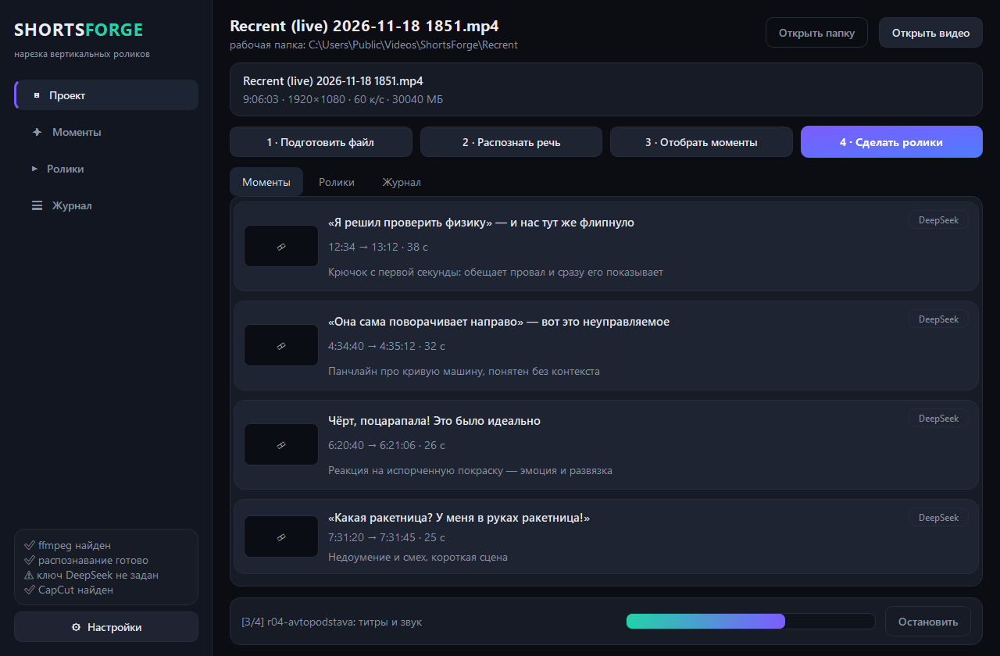
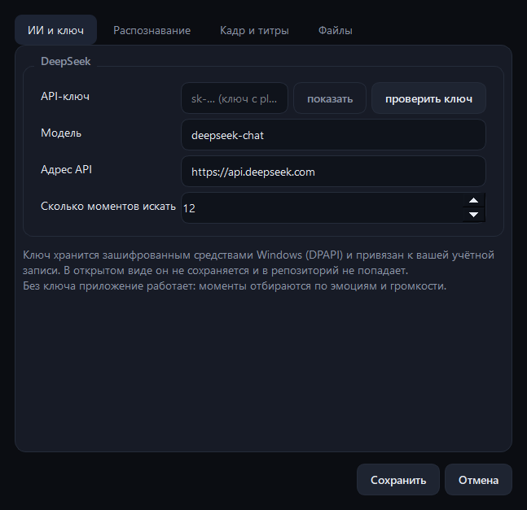

# ShortsForge

Настольное приложение (Windows) для нарезки вертикальных коротких видео — Shorts, Reels,
TikTok, VK Клипы — из длинных записей стримов и любых больших видеофайлов.



## Что нового в 1.2 (26.11.2026)

- **Починен левый раздел.** Раньше кнопки «Моменты / Ролики / Журнал / Очередь» переключали
  только вкладки, а сама страница оставалась прежней: зайдя в «Очередь», из неё было не выйти,
  и меню выглядело мёртвым. Теперь раздел переключается целиком, а из очереди есть возврат.
- **Не падает при открытии подготовленной записи.** Оценка времени расшифровки брала длительность
  у путей к кускам, а у пути её нет — приложение вылетало сразу после открытия файла. Добавлена
  проверка на этот случай в `tests/test_units.py` (теперь 29 проверок).
- **Оформление.** Разделы подписаны, у активного пункта акцентная полоса; значки состояния
  переехали в шапку (имя файла больше не дублируется); кнопки крупнее, страница очереди собрана
  в карточку с понятной пустой подсказкой; эмодзи из подписей убраны — на Windows 10 они
  рисовались пустыми квадратами.

Внутри полный конвейер, собранный и проверенный на реальных 9-часовых записях Twitch:

| Шаг | Что делает |
|---|---|
| **1. Подготовка** | Проверяет файл и, если запись «сырая» (склейка HLS-кусков), перепаковывает её по часу без пережатия. На нормальном mp4 шаг занимает доли секунды. |
| **2. Найти моменты** | Сначала один быстрый проход по звуку (2,5 часа записи ≈ 35 секунд), потом расшифровка только самых громких мест, мест всплесков в чате и равномерной сетки. DeepSeek читает этот текст и предлагает моменты с крючком, заголовком и хештегами. Кнопка «Расшифровать всё» — медленный путь без пропусков. |
| **3. Ролики** | Режет 9:16, кладёт вебку сверху и игру снизу, делает титры по словам с подсветкой, крупные выкрики отдельной дорожкой, глушит мат в звуке, собирает готовый mp4 **и** редактируемый проект CapCut. |
| **4. Очередь на ночь** | Можно добавить сразу несколько записей: приложение обработает их по очереди и сложит ролики в папку вывода. Один сломанный файл не останавливает остальные. |
| **Кэш** | Всё посчитанное (громкость, расшифровка, моменты, окно вебки) хранится по отпечатку файла. Повторный прогон той же записи не пересчитывает ничего — замерено: 79 с → 42 с на 6-минутной записи. |
| **Чат стрима** | Если рядом с записью лежит лог чата (TwitchDownloader, `yt-dlp --write-chat`, простой текст), всплески сообщений добавляются к местам для нарезки: зрители пишут там, где правда смешно. |

| **Проверка** | После сборки сверяет титры с собственным звуком ролика и проверяет целостность проекта CapCut. |

### Сколько это занимает (замерено на записи 2 ч 24 мин, видеокарта GTX 1060)

| Этап | Было | Стало |
|---|---|---|
| Подготовка файла | 77 с | **0,1 с** |
| Поиск моментов | ~23 мин (полная расшифровка) | **2,3 мин** |
| Полный цикл до двух готовых роликов | ~27 мин | **4 мин** |
| Сборка одного ролика | ~70 с | ~50 с |

Где было медленно и что сделано: решатель перепаковки читал файл целиком (8 ГБ → 77 секунд),
а расшифровывалась вся запись, хотя роликов нужно 10–15. Теперь один проход по громкости
плюс расшифровка ~48 окон по 26 секунд.




## Готовый .exe (без установки Python)

В релизах лежит **`ShortsForge.exe`** — один файл, всё внутри: ffmpeg, шрифты, шаблон CapCut,
интерфейс. Python и pip не нужны, достаточно распаковать и запустить.

- Первый запуск занимает ~10 секунд (файл распаковывается во временную папку), дальше быстрее.
- Собрать самому: `python build_exe.py` → `dist/ShortsForge.exe` (~280 МБ).
- Проверить собранный файл: `ShortsForge.exe --selftest` — печатает отчёт (13 проверок) и пишет
  лог в `%LOCALAPPDATA%\ShortsForge\selftest.log`.

### Видеокарта и CUDA

Библиотеки CUDA (cublas + cudnn, ~1,3 ГБ распакованными) в .exe намеренно **не входят** —
иначе файл раздувается втрое. Если на машине есть NVIDIA и хочется распознавать на ней:

```bat
python tools\install_cuda_pack.py
```

Скрипт положит библиотеки в `%LOCALAPPDATA%\ShortsForge\cuda`, и приложение подхватит их само
(и .exe, и запуск из исходников). Без них распознавание идёт на процессоре — работает, но
медленнее; на GTX 1060 разница примерно в пять раз (x6,4 против x1,2 реального времени).

## Установка из исходников

Нужны Windows, Python 3.10+ (проверено на 3.14) и ffmpeg (в PATH или в папке AIEditor).

```bat
pip install -r requirements.txt
python -m shortsforge
```

Либо просто запустить `run.cmd`: он сам поставит зависимости при первом запуске.


## Свой ключ DeepSeek

Ключ вводится в приложении: **Настройки → ИИ и ключ → API-ключ DeepSeek**, там же кнопка
проверки ключа. Ключ шифруется средствами Windows (DPAPI) и привязан к вашей учётной записи;
в открытом виде он не сохраняется и в репозиторий не попадает. Получить ключ:
https://platform.deepseek.com/api_keys

Переменная окружения `DEEPSEEK_API_KEY` имеет приоритет — удобно для запуска из консоли.

Без ключа всё работает, кроме ИИ-отбора: моменты выбираются эвристикой.

## Что внутри

```
shortsforge/
├─ core/            бизнес-логика без интерфейса
│  ├─ media.py      ffmpeg, зондирование, перепаковка, карта времени, измерение звука
│  ├─ transcribe.py faster-whisper: подбор устройства, откат cuda → cpu
│  ├─ layout.py     поиск окна вебки по лицу (OpenCV YuNet)
│  ├─ analysis.py   окна по громкости, запасной отбор, текст для ИИ
│  ├─ deepseek.py   клиент API: отбор моментов, разбор ответа
│  ├─ captions.py   субтитры по словам, мат в титрах и в звуке
│  ├─ render.py     слои, предпросмотр, выкрики
│  ├─ capcut.py     экспорт проекта CapCut (слои разными дорожками) + проверка
│  ├─ verify.py     сверка титров с собственным звуком ролика
│  └─ pipeline.py   шаги конвейера, состояние проекта в project.json
├─ ui/              PySide6: главное окно, настройки, тема, фоновые задачи
├─ assets/          шаблон черновика CapCut, снимки экрана
└─ tests/           модульные и сквозные проверки
```

## Проверки

```bat
python tests\test_units.py          :: 26 проверок без медиа (субтитры, мат, разбор ИИ, настройки)
python tests\smoke_core.py          :: окружение, вебка по лицу, распознавание, проект CapCut
python tests\e2e_pipeline.py <видео> :: полный проход на реальном файле с отчётом
```

На реальной записи (9 часов Twitch) результат: 14 роликов 18–40 секунд, у каждого проект CapCut
со слоями `основа` / `вебка` / `выкрики` / `субтитры` на разных дорожках, сверка титров дала
сдвиг в пределах ±0,5 с.

## Грабли, которые уже собраны (и обойдены в коде)

- Перемотка в «сырой» записи стрима может стоить минуты, а иногда попадает не туда: приложение
  измеряет фактическое начало куска по форме звука и ставит титры по факту.
- Слова для титров нельзя брать из общей расшифровки записи: у сырого звука и у перепакованных
  кусков разные шкалы времени (расхождение до 10 секунд). Каждый ролик распознаётся заново по
  своему звуку.
- Громкий пик — часто выстрел, а не речь; момент привязывается к слову-крючку.
- На видеокартах без int8/fp16 (GTX 1060) ctranslate2 работает только в `float32`;
  приложение пробует сам и откатывается на процессор.
- В CapCut каждый слой должен быть на своей дорожке: два куска в одной дорожке редактор видит
  как мусор.
- Выкрик и титр не должны дублировать одно слово, а длинный выкрик — вылезать за кадр.

## Лицензия

MIT.

